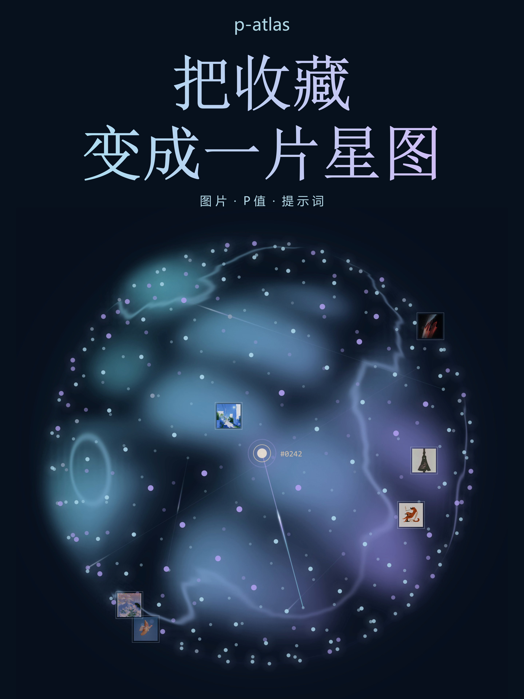
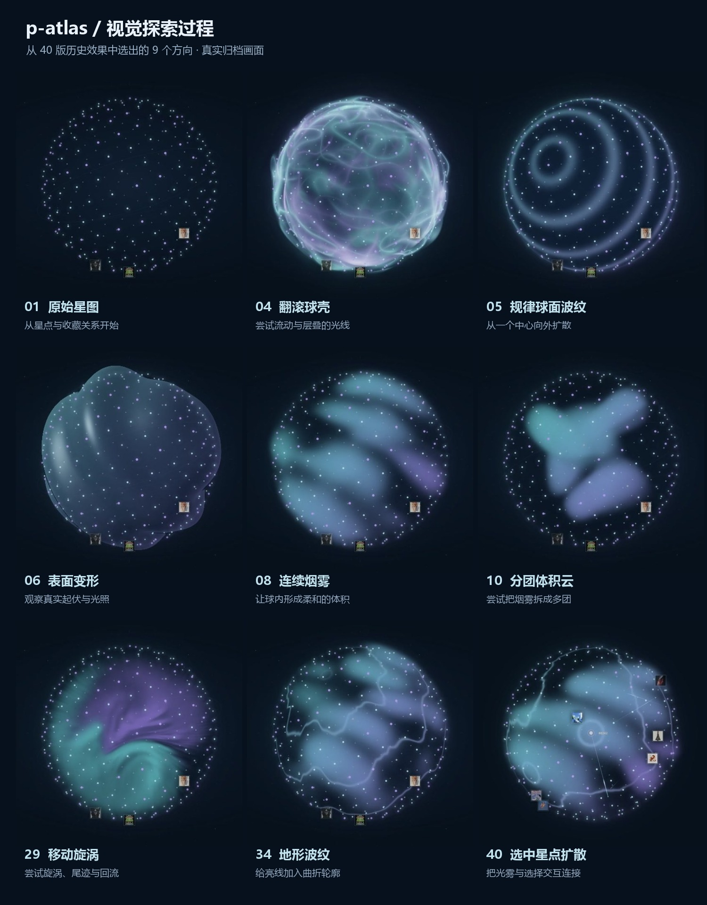

# P Atlas

**Explore your Midjourney collection as an interactive constellation.**

[Live demo](https://p-atlas.secondworld.site/) · [4K video](https://github.com/tstrangers/p-atlas/releases/latest) · [中文](README.md)

<a href="docs/media/cover-4k.jpg"></a>

The release includes a 30-second, 30fps **2880×3840 (3:4) video**, with and without music. It uses the native 3840-square sphere export and freshly rendered typography and cards, rather than stretching the previous 1080p video. [Full-resolution cover](docs/media/cover-4k.jpg) · [Native scene preview](docs/media/hero-4k.jpg).

Rotate a glowing sphere, select a star, and discover its image, prompt, personalization profiles and generation parameters. Images sharing a P profile are connected by animated gradient lines.

## Features

- 3D sphere projection with drag, wheel and pinch controls.
- Smooth focus, selected-star pulses and a fourth ripple source.
- Original WebGL volumetric smoke and three wandering, independently timed contour-wave sources.
- Profile / prompt / collection-number search, P filtering and in-page full-size previews.
- P-combination deduplication, regardless of parameter ordering.
- Pause controls, reduced-motion support and graphics fallbacks.
- Static files, local data, no API key or runtime framework dependencies.

The included collection contains 339 nodes and 501 distinct P profiles, deduplicated from 378 records. P refers to Midjourney personalization (`--p` / `--profile`), not a statistical p-value. Edges mean shared profile codes, not semantic similarity.

## Visual exploration

The sphere evolved through layered shells, regular ripples, surface deformation, volumetric smoke, separated clouds, vortices and terrain-like contours. These are real archived renders, including experiments that were later discarded.

[](docs/visual-history.md)

The current direction combines continuous smoke with wandering, independently timed contour waves and a selection-driven fourth source. See the **[40-version visual archive](docs/visual-history.md)** for all frames and notes (Chinese). Archive numbers follow the export collection, not a strict development timeline. These are historical experiments, not selectable themes in the current app.

## Run

```bash
python -m http.server 4173 --bind 127.0.0.1 --directory dist
```

Open <http://127.0.0.1:4173/>. Deploy `dist` to any static host. Vercel configuration is included; select Other, leave build/install commands empty, and set the output directory to `dist`.

Edit `dist/data.js` to use your own collection; see [data schema](docs/data.md). Run `npm test` to validate data, focus behavior and rendering precision. `npm install` is only needed for the optional `sharp` image-preparation tool.

## Open-source edition

This repository preserves the current atlas interaction and original sphere renderer. The production site has used a proprietary AeroShards background supplied from React Bits Pro. That implementation and the private development history are excluded. This edition uses the project's original Canvas particle background and needs no React Bits Pro license.

The demo video combines previously rendered sphere footage with actual collection data in an editorial layout; it is not a full browser interaction recording.

Original code is licensed under [MIT](LICENSE). Collection images, prompts, profile configurations and promotional media are excluded from that grant; see [content terms](CONTENT_LICENSE.md). Replace demo content with your own material for your public deployment.

Visual reference: [React Bits Pro](https://pro.reactbits.dev/docs/introduction), under its [own license](https://pro.reactbits.dev/license). This project is not affiliated with Midjourney or React Bits.
