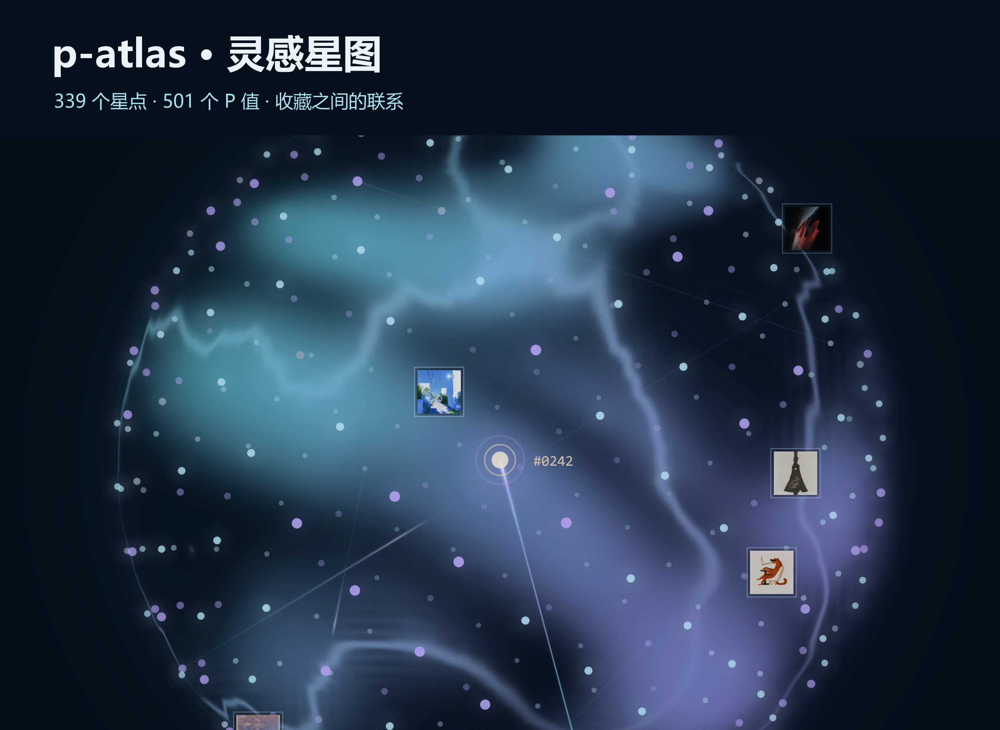
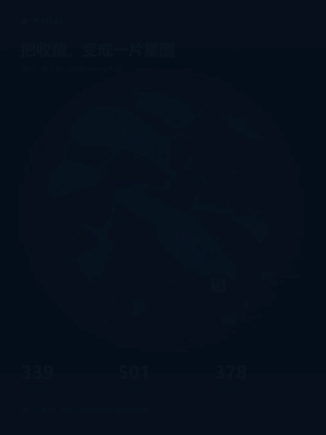
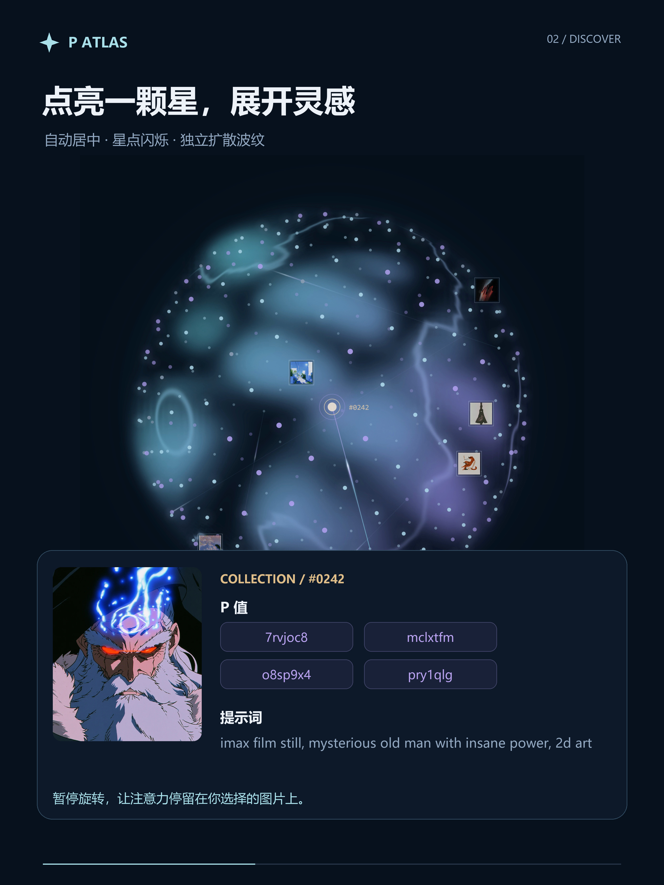
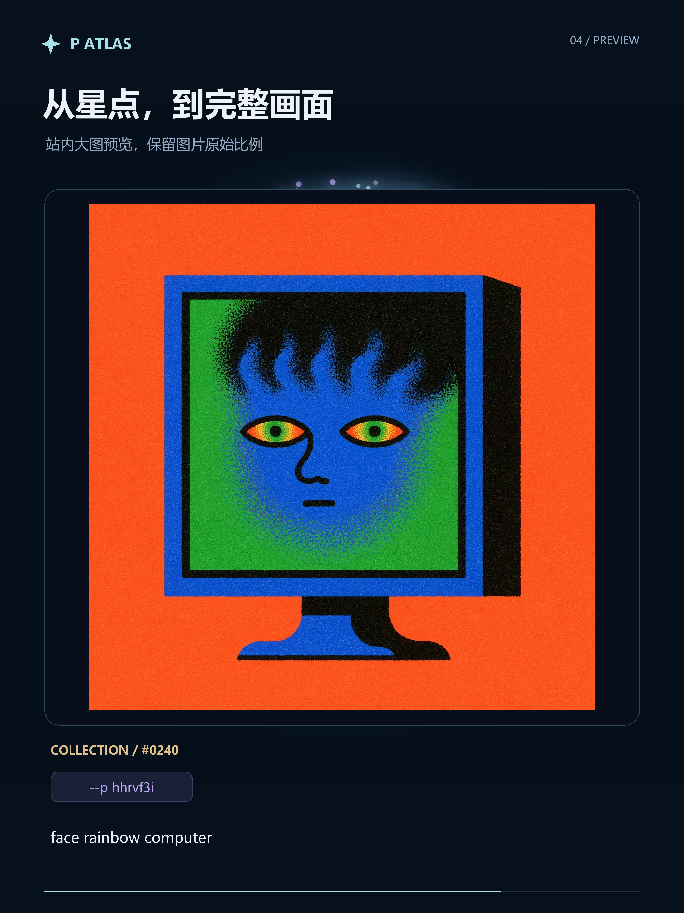

<div align="center">

# P Atlas · 灵感星图

**把 Midjourney 收藏，变成一片可以探索的星空。**

图片、提示词与 P 值不再散落在收藏夹里。旋转星球，点亮一颗星，找回它的画面、参数，以及与其他图片的联系。

[在线体验](https://p-atlas.secondworld.site/) · [4K 演示视频](https://github.com/tstrangers/p-atlas/releases/latest) · [数据说明](docs/data.md) · [English](README.en.md)

<a href="docs/media/cover-4k.jpg"></a>

原生 JavaScript · Canvas 2D · WebGL · 无框架运行依赖 · 纯静态部署

</div>

## 它能做什么

- **把图片放进球形星图**：拖动旋转、滚轮与双指缩放，缩略图与星点一起分布在球面上。
- **点亮并聚焦**：选中星点后停止自动旋转，平滑转到正面中心，柔和闪烁，并产生独立的第四组扩散波纹。
- **一次找回完整信息**：图片、P 值、提示词与其他参数集中展示；支持一键复制 P 值和提示词。
- **看见关联**：共享相同 P 值的图片以青紫渐变流光连线；点击 P 值可筛选相关星点。
- **在站内预览大图**：保持图片比例，关闭预览后回到原卡片。
- **按整组 P 值去重**：忽略参数顺序，合并完全相同的 P 组合；不同组合保留，未标注 P 值的图片独立保留。
- **实时烟雾与波纹**：WebGL 体积光雾、三个强弱不同且随机错峰发波的移动源、会弯曲和融合的等高线波纹。
- **兼顾使用体验**：支持键盘、暂停、系统“减少动态效果”和 WebGL 不可用时的柔光降级。

示例收藏含 **378 张原始记录 → 339 个星点 · 501 个不同 P 值**。连线表示共享 P 值，**不是**语义相似度、模型训练关系或效果保证。这里的 P 指 Midjourney 的 `--p` / `--profile` 个性化参数，不是统计学 p-value。

<details>
<summary>展开动态演示与功能画面</summary>

[](docs/media/hero-4k.jpg)

<p align="center"></p>

| 星点详情 | 大图预览 |
| --- | --- |
|  |  |

上方动图是便于加载的轻量预览。**2880×3840 原生素材制作的 3:4 竖版 4K 视频**、无配乐版及高清封面可从 [Release](https://github.com/tstrangers/p-atlas/releases/latest) 下载；30 秒、30fps。球体来自此前 3840×3840 的逐帧导出，文字与卡片在输出分辨率重新绘制，不是将旧版 1080p 视频直接放大。视频不含仓库链接、体验网址或引流文案。

[查看 2880×3840 原尺寸封面](docs/media/cover-4k.jpg)

</details>

## 视觉探索过程

现在的球体效果经历了多轮试验：从基础星点、翻滚球壳、规律环纹，到表面形变、体积烟雾、旋涡和地形波纹。下面选出 9 个差异明显的方向，画面均来自此前保存的真实渲染。

[](docs/visual-history.md)

这个过程中，我们逐步明确了想保留的体验：烟雾要有体积与明暗，亮线要像地形等高线一样曲折，扩散源要移动、强弱不同并随机错峰，选中的星点也应参与其中。旋涡和分团云曾被尝试，后来回到了连续烟雾、涟漪与多源扩散的组合。

**[查看完整 40 版效果图鉴 →](docs/visual-history.md)**，包含中间状态、舍弃的方向与简短说明。编号沿用历史导出合集，不代表严格的开发时间顺序；这些图片是探索记录，不是网页内可切换的主题。

## 立即运行

下载仓库后，在项目目录运行：

```bash
python -m http.server 4173 --bind 127.0.0.1 --directory dist
```

打开 <http://127.0.0.1:4173/>。不需要 API Key、Midjourney 登录、React 或构建步骤。图片与数据来自本地静态文件，运行时不会向 Midjourney 请求收藏。

| 操作 | 方式 |
| --- | --- |
| 旋转与缩放 | 拖动 / 滚轮 / 双指 |
| 查找图片 | 搜索 P 值、提示词或原收藏编号；`/` 聚焦搜索 |
| 查看详情 | 点击星点；也可聚焦星图，用方向键选择后按 Enter |
| 查看关联 | 点击详情中的 P 值或关联缩略图 |
| 关闭预览或详情 | 关闭按钮 / Esc |
| 冻结动画 | 底部暂停按钮；也遵循系统减少动态效果设置 |

## 换成自己的收藏

可以直接编辑 `dist/data.js`，并将图片放入 `dist/assets/images/`、缩略图放入 `dist/assets/thumbs/`。字段与最小示例见 [数据说明](docs/data.md)。更换数据后执行 `node check-data.mjs`，检查去重、关联和资源路径。

已有“清单.json + 提取.json + 原图”数据时，可以使用转换工具：

```bash
npm install
node prepare.mjs --source "你的收藏文件夹"
node check-data.mjs
```

`sharp` 只用于本地转换图片；网页运行不依赖它。工具不负责抓取 Midjourney 收藏，也不提供自动登录或爬虫。

## 部署

任何静态托管服务都可以直接发布 `dist`。Vercel 配置已包含在 `vercel.json`：

| 选项 | 值 |
| --- | --- |
| Framework | Other |
| Build command | 空 |
| Install command | 空 |
| Output directory | `dist` |

GitHub Pages 也可以使用 Actions 将 `dist` 作为静态站点产物上传。全部站内资源使用相对路径。

## 代码结构

```text
dist/
  app.js             星图投影、选择居中、关联、搜索与大图预览
  aura.js            原创 WebGL 烟雾、光晕与多源波纹
  shards.js          原创 Canvas 折面粒子背景
  data.js            图片、P 值、提示词与边
  assets/            图片与缩略图
  style.css          页面布局与降级效果
prepare.mjs          本地收藏转换工具
check-data.mjs       数据与图片资源检查
tests/               聚焦交互与渲染精度验证
```

运行检查：`npm test`。浏览器端重点使用原生 API；球面通过三维坐标投影到 Canvas，烟雾通过 WebGL 沿视线多次采样绘制。更多说明见 [渲染与交互](docs/rendering.md)。

## 开源版与线上展示版

本仓库包含最新星图交互和原创球体效果。线上展示版使用过来自 **React Bits Pro** 的 AeroShards 星屑；其源码及私有开发历史**不包含在这个公开仓库中**。公开版使用项目自身的 Canvas 粒子背景，因此星屑观感有所不同；运行无需 React Bits Pro 许可证。

演示视频由本项目此前逐帧导出的球体动画与实际收藏数据剪辑合成，信息卡片为演示排版，不是完整浏览器操作录屏。视频没有展示或分发 React Bits Pro 源码。

## 许可与致谢

项目原创代码采用 [MIT License](LICENSE)。收藏图片、提示词、P 配置和演示媒体不纳入 MIT 授权，见 [内容使用说明](CONTENT_LICENSE.md)。使用自己的收藏替换示例内容后，再发布自己的版本。

视觉参考来源：[React Bits Pro](https://pro.reactbits.dev/docs/introduction)。其商业组件仍适用[原有许可](https://pro.reactbits.dev/license)，不因本项目开源而获得再分发授权。本项目与 Midjourney、React Bits 均无隶属关系。

欢迎通过 Issue 提交问题，或通过 Pull Request 改善性能、数据导入和无障碍体验。贡献指引见 [CONTRIBUTING.md](CONTRIBUTING.md)。
