# 40 版球体效果图鉴

[返回项目介绍](../README.md#视觉探索过程)

这组画面来自此前已经保存的球体动画导出，不是为介绍页重新绘制的概念图。它记录了基础星点、层叠光晕、表面形变、体积烟雾、旋涡以及等高线波纹等尝试，也保留了后来没有采用的中间状态。

**如何阅读**：编号沿用历史导出合集；主要备份、恢复出的细分状态与交互版本被收在同一份归档里，因此编号不代表严格的开发时间顺序。静帧适合比较光照、轮廓和烟雾分布，移动速度、随机发波与回流需要结合动画理解。这些归档不是当前网页里的可切换主题。

## 最后保留下来的方向

- 保留连续烟雾与柔和涟漪，让球体内部有明暗、空间与流动。
- 从规整圆环继续探索地形等高线，让扩散轮廓更加曲折。
- 让三个源移动、强弱有别、随机错峰发波，交接处平滑融合。
- 把选择行为接进效果：选中星点居中、闪烁，并成为第四个扩散源。

旋涡和多团分离云也曾尝试，但没有作为最终球体的主体效果。

## 代表方向

## 完整归档

点击图片可查看单张原始预览。为便于横向比较，所有预览保留了原有的方形构图。

| 01 · 原始星图球体 | 02 · 流动薄雾光晕 |
| --- | --- |
| [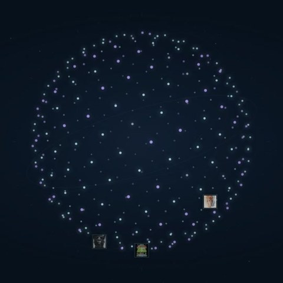](media/iterations/01_original.jpg) | [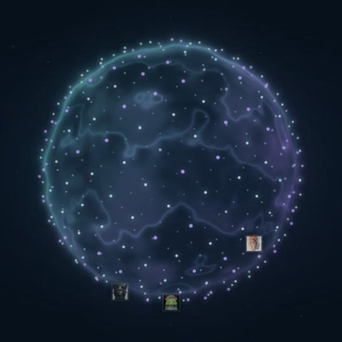](media/iterations/02_flowing-aura.jpg) |
| 基础球面星点与图片分布。 | 在星点外加入流动薄雾和光晕。 |

| 03 · 紫色层叠体积光 | 04 · 青紫翻滚球壳 |
| --- | --- |
| [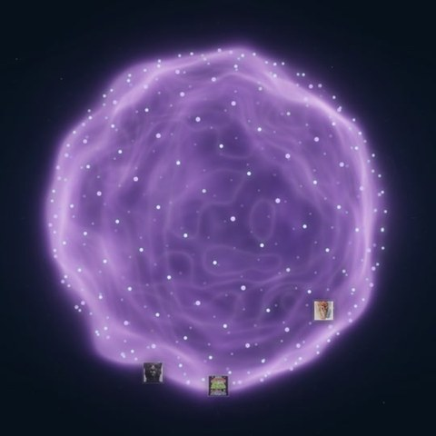](media/iterations/03_purple-volume.jpg) | [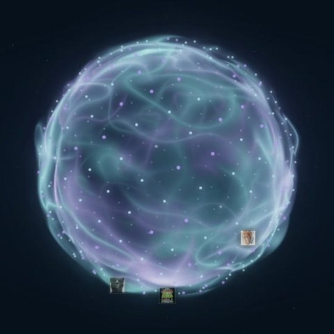](media/iterations/04_tumbling-shells.jpg) |
| 尝试更明显的紫色体积与层叠关系。 | 球壳翻滚与青紫光线交织。 |

| 05 · 规律球面波纹 | 06 · 真实表面起伏 |
| --- | --- |
| [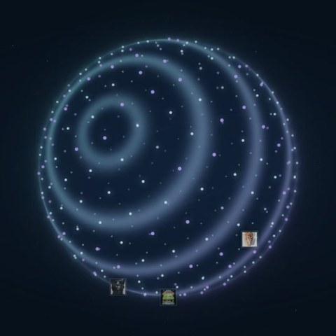](media/iterations/05_regular-ripples.jpg) | [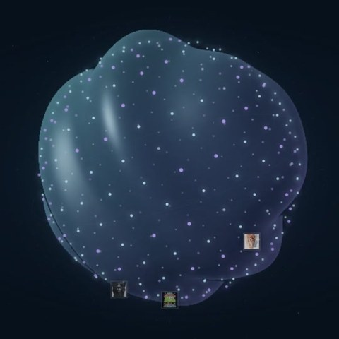](media/iterations/06_surface-deformation.jpg) |
| 尝试规律的球面扩散环纹。 | 尝试真实表面起伏及其光照变化。 |

| 07 · 辉光与曝光 | 08 · 连续烟雾涟漪 |
| --- | --- |
| [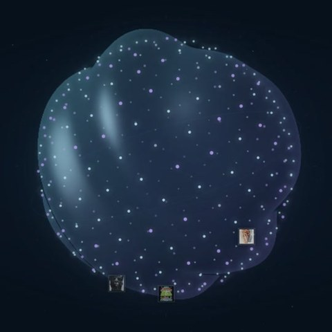](media/iterations/07_bloom-exposure.jpg) | [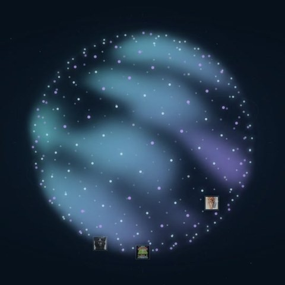](media/iterations/08_volume-ripples.jpg) |
| 调整辉光与曝光，观察亮部和暗部的平衡。 | 从表面光照转向连续体积烟雾与涟漪。 |

| 09 · 三源随机地形等高线 | 10 · 六团分离体积云 |
| --- | --- |
| [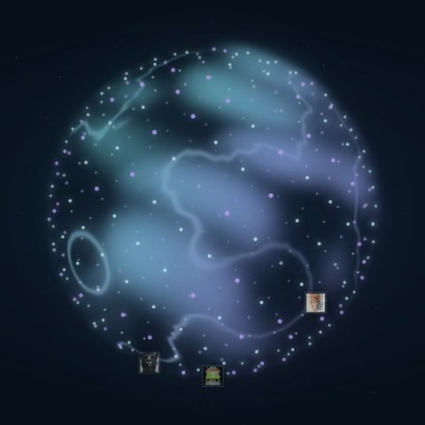](media/iterations/09_three-random-sources.jpg) |  |
| 多源随机发波与地形轮廓方向的主要备份。 | 尝试分离成多团的体积云。 |

| 11 · 紫色体积早期参数 | 12 · 球面起伏波纹初版 |
| --- | --- |
| [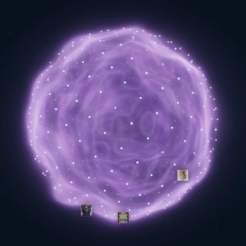](media/iterations/11_purple-volume-early.jpg) | [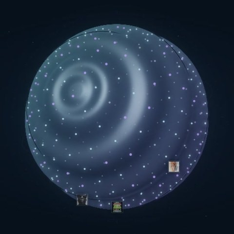](media/iterations/12_recovered-surface-radial-initial.jpg) |
| 紫色体积方向的早期参数状态。 | 表面起伏与单中心环纹的初次结合。 |

| 13 · 球面起伏波纹采样改进 | 14 · 轻度扭曲球面波纹 |
| --- | --- |
| [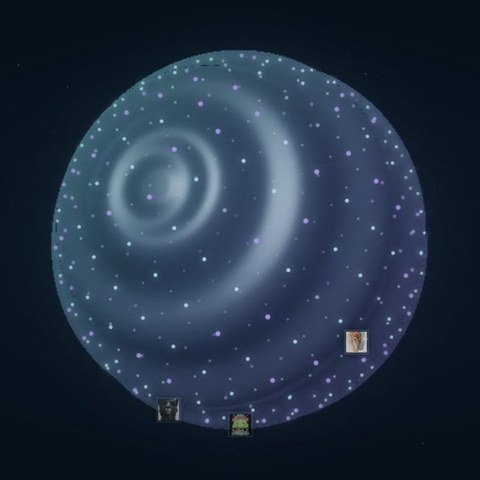](media/iterations/13_recovered-surface-radial-refined.jpg) | [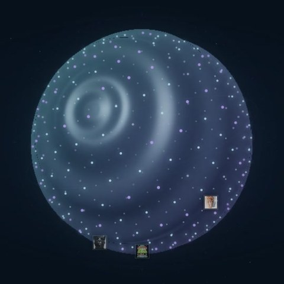](media/iterations/14_recovered-surface-warped-radial.jpg) |
| 改进球面波纹的采样表现。 | 给规则环纹加入轻度扭曲。 |

| 15 · 柔和分布式表面起伏 | 16 · 连续体积云初版 |
| --- | --- |
| [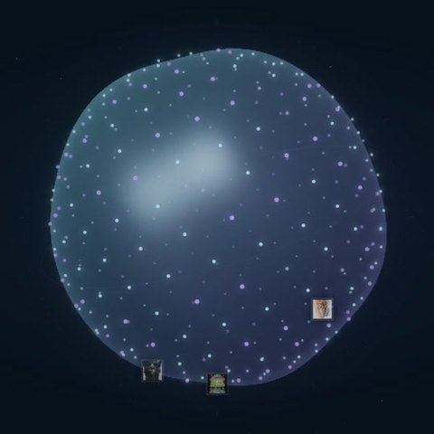](media/iterations/15_recovered-surface-distributed-gentle.jpg) | [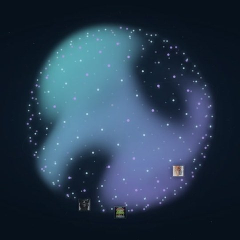](media/iterations/16_recovered-volume-continuous-initial.jpg) |
| 尝试分布式起伏，减弱单点扩散的主导感。 | 连续烟雾方向的早期状态。 |

| 17 · 六团分离体积云 | 18 · 连续烟雾涟漪初版 |
| --- | --- |
|  | [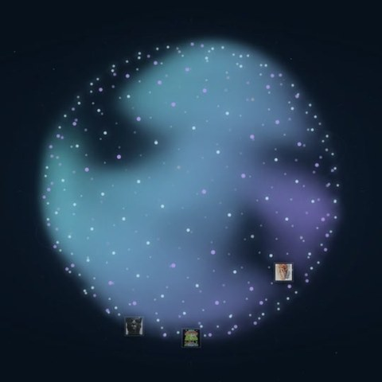](media/iterations/18_recovered-volume-ripple-initial.jpg) |
| 六团分离体积云的细分试验。 | 在连续烟雾中加入涟漪。 |

| 19 · 增强连续烟雾涟漪 | 20 · 流体烟雾初版 |
| --- | --- |
| [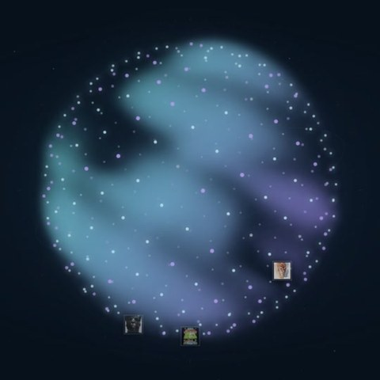](media/iterations/19_recovered-volume-ripple-stronger.jpg) | [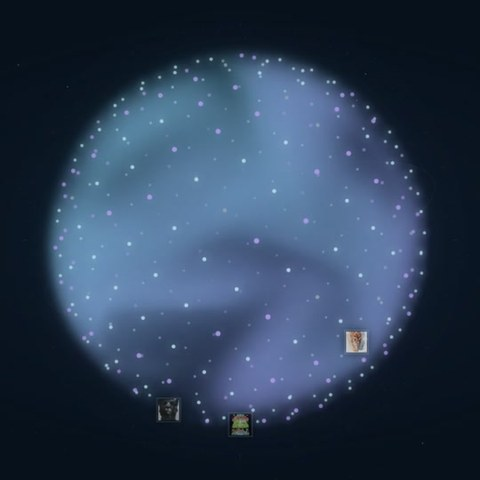](media/iterations/20_recovered-fluid-initial.jpg) |
| 增强烟雾涟漪的可见变化。 | 流体烟雾方向的初始试验。 |

| 21 · 流体烟雾暗隙版 | 22 · 高分辨率旋涡试验 |
| --- | --- |
| [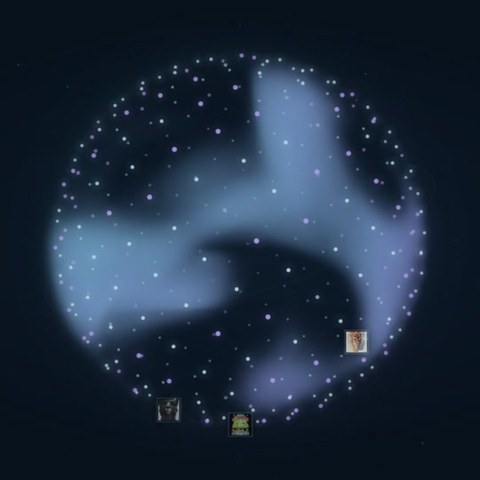](media/iterations/21_recovered-fluid-concentrated.jpg) |  |
| 调整烟雾集中程度与暗隙。 | 提高旋涡试验的渲染分辨率。 |

| 23 · 旋涡求解器修正版 | 24 · 旋涡细长尾迹 |
| --- | --- |
| [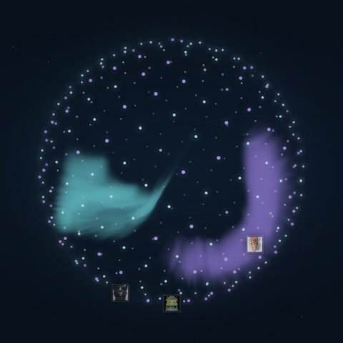](media/iterations/23_recovered-vortices-solver-fix.jpg) | [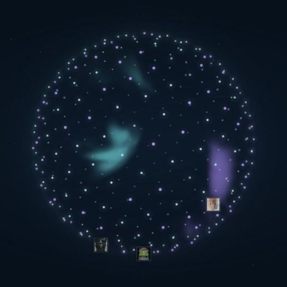](media/iterations/24_recovered-vortices-thin-trails.jpg) |
| 修正旋涡求解过程。 | 尝试更细长的流动尾迹。 |

| 25 · 旋涡暗心与薄烟 | 26 · 旋涡染料限幅版 |
| --- | --- |
| [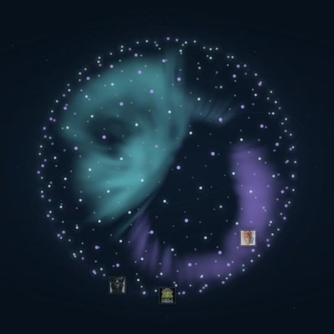](media/iterations/25_recovered-vortices-dark-cores.jpg) | [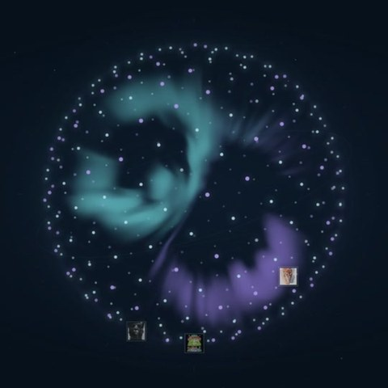](media/iterations/26_recovered-vortices-bounded-dye.jpg) |
| 强化旋涡暗心，调整薄烟分布。 | 限制染料累积，控制烟雾的浓度。 |

| 27 · 固定中心旋涡 | 28 · 固定旋涡浓雾版 |
| --- | --- |
| [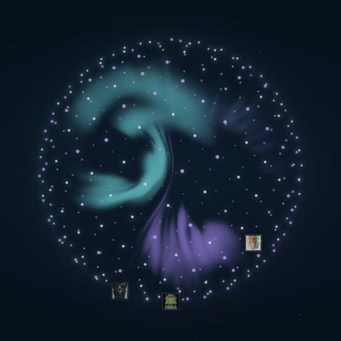](media/iterations/27_recovered-vortices-fixed.jpg) | [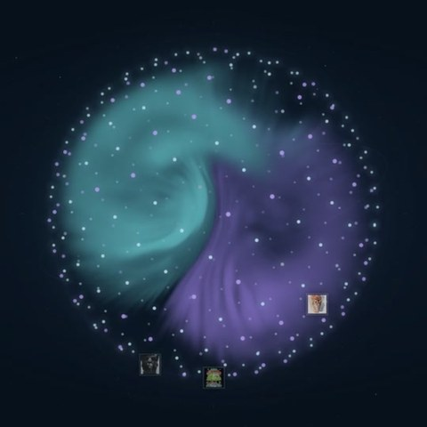](media/iterations/28_recovered-vortices-more-fog.jpg) |
| 观察固定中心的旋涡和回流。 | 在固定旋涡基础上增加雾气。 |

| 29 · 移动中心旋涡 | 30 · 双倍速度烟雾涟漪 |
| --- | --- |
| [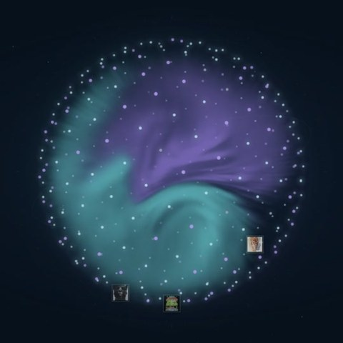](media/iterations/29_recovered-vortices-moving.jpg) | [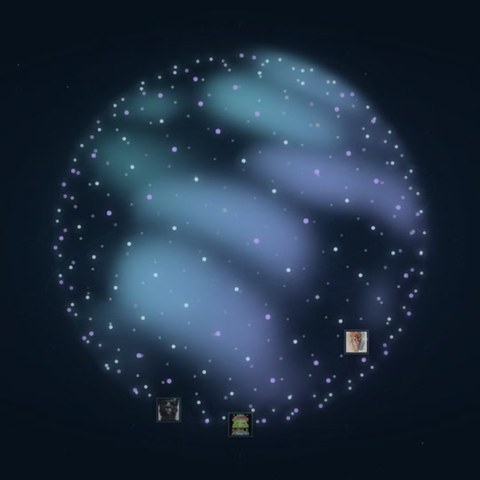](media/iterations/30_recovered-smoke-ripple-fast.jpg) |
| 让旋涡中心在球内移动。 | 去掉旋涡，回到更快的烟雾与涟漪。 |

| 31 · 烟雾涟漪去底部轨道 | 32 · 单源不规则扩散圈初版 |
| --- | --- |
|  | [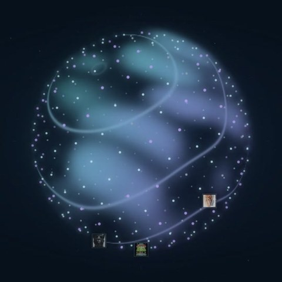](media/iterations/32_recovered-expanding-rings-initial.jpg) |
| 移除底部轨道线，简化球体周边。 | 在烟雾上加入向外扩散的不规则亮圈。 |

| 33 · 单源闭合不规则扩散圈 | 34 · 单源地形等高线 |
| --- | --- |
| [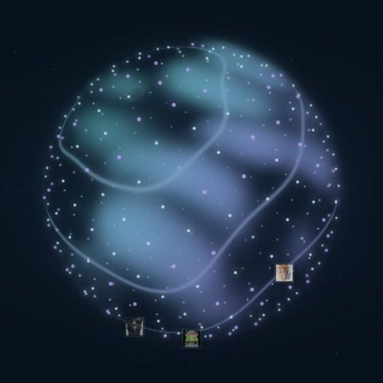](media/iterations/33_recovered-expanding-irregular-rings.jpg) | [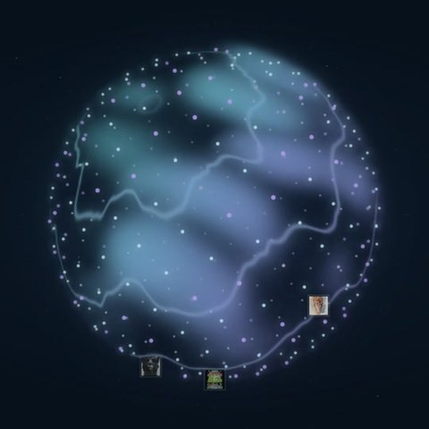](media/iterations/34_recovered-terrain-contours-single.jpg) |
| 继续调整闭合扩散圈的形状。 | 用地形等高线的曲折程度丰富轮廓。 |

| 35 · 游走单源密集等高线 | 36 · 三源融合等高线 |
| --- | --- |
| [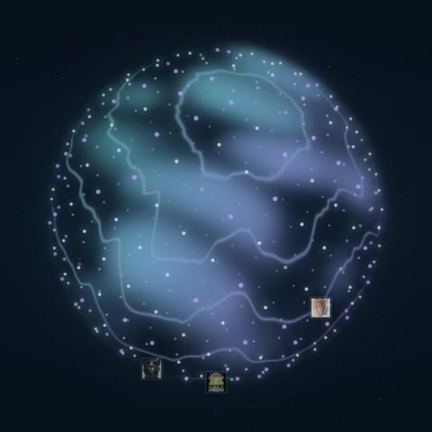](media/iterations/35_recovered-terrain-contours-moving-dense.jpg) | [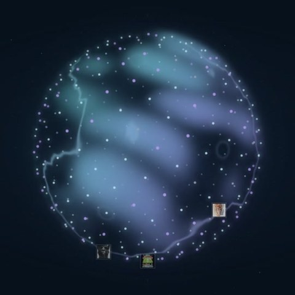](media/iterations/36_recovered-terrain-contours-three.jpg) |
| 尝试更密的发波与移动扩散源。 | 扩展到三个源，并处理波纹交接。 |

| 37 · 三源宽幅游走与强中弱等高线 | 38 · 三源随机发波等高线 |
| --- | --- |
| [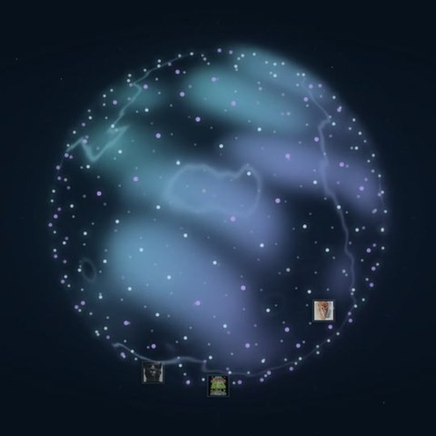](media/iterations/37_recovered-terrain-contours-roaming-strength.jpg) | [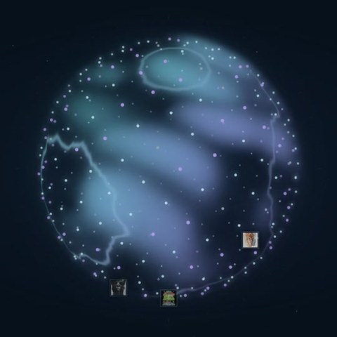](media/iterations/38_recovered-terrain-contours-random-births.jpg) |
| 让三源宽幅游走，并形成强、中、弱层次。 | 让三源按独立的随机时刻出生波纹。 |

| 39 · 纯色背景与连线流光 | 40 · 选中星点第四扩散源 |
| --- | --- |
| [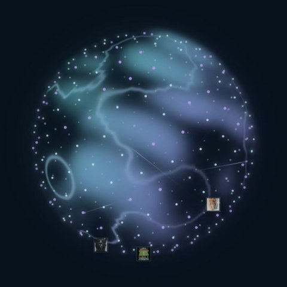](media/iterations/39_current-flow.jpg) | [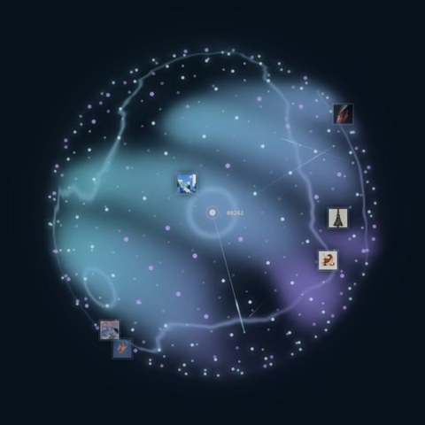](media/iterations/40_current-selected.jpg) |
| 移除背景装饰，并加入共享 P 值连线流光。 | 选中星点居中、闪烁，并触发第四个扩散源。 |

以上展示只包含渲染画面。第三方商业组件源码与私有开发日志不在公开仓库中；图片使用范围见 [内容说明](../CONTENT_LICENSE.md)。
